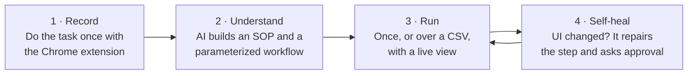
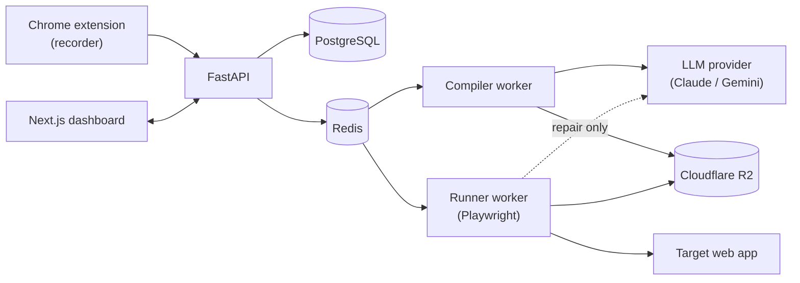

# WatchOnce

**Show it once. It's automated forever.**

WatchOnce turns a single recorded demonstration of a browser task into a documented, parameterized automation. It runs deterministically, scales over a spreadsheet of inputs, asks a human before risky steps, and **repairs itself when the target app's UI changes**.

> **Status:** 📐 Design complete · MVP in development. This repository currently contains the full product and engineering design. Code lands following the [build plan](docs/14-roadmap-build-plan.md).

---

## The problem

Operations teams spend hours every day on repetitive work inside web apps that have no API: vendor portals, ERPs, legacy admin panels, government and insurance forms.

- **Doing it by hand** is slow, error-prone and demoralizing.
- **Traditional RPA** needs specialist developers and expensive licenses, and the bots break whenever a button moves.
- **AI browser agents** call an LLM on every step of every run. They're slow, cost money on every run, and are non-deterministic, which is hard to trust with finance or HR data.

## How WatchOnce works



1. **Record.** The person who already does the task records it once in the browser. Passwords are never captured.
2. **Understand.** AI turns the recording into a step-by-step SOP with screenshots and a workflow with named inputs (`vendor_name`, `amount`, `due_date`). It also marks risky steps (submit, pay, delete) as human-approval checkpoints.
3. **Run.** Run it once, or over 500 rows of a CSV, with a live view of the browser. Runs are **deterministic, with zero AI calls**.
4. **Self-heal.** When the target app changes, WatchOnce tries backup locators, then similarity matching, and only then asks AI to pick the right element. Every repair is logged with before/after screenshots and needs approval.

## Why it's different

| | Traditional RPA | AI browser agents | **WatchOnce** |
|---|---|---|---|
| Who builds it | RPA developer | Prompt writer | The employee who already does the task |
| AI cost per run | – | Every step, every run | **$0** (AI only at build and repair time) |
| Predictability | High | Low | **High**: deterministic replay |
| When the UI changes | Breaks | Adapts, sometimes wrongly | **Self-heals, with an audit trail and approval** |
| Documentation | Separate effort | None | **SOP generated automatically** |
| Risky actions | Scripted | Model decides | **Human-approval checkpoints** |

## Enterprise-grade by design

- 🔐 **Credentials encrypted** (envelope encryption) and never shown, logged or sent to AI
- 🛡️ **Prompt-injection resistant**: AI can only choose among real page elements and never decides actions or values at run time
- 🌐 **Domain allowlist** per workflow, enforced at the network layer
- ✋ **Human-in-the-loop checkpoints** before irreversible steps
- 📜 **Append-only audit log** of every edit, run, approval and repair
- 🧪 **Evals in CI**: compile accuracy, heal success, and zero wrong-element heals

## Architecture



| Layer | Tech |
|---|---|
| Recorder | Chrome Extension (MV3), TypeScript |
| Dashboard | Next.js, TypeScript, Tailwind, shadcn/ui |
| API & workers | FastAPI, SQLAlchemy, Celery, Redis |
| Automation | Playwright (Chromium) |
| AI | Pluggable provider: Claude (`claude-opus-5-5`) or Gemini |
| Data | PostgreSQL, Cloudflare R2 |
| Ops | Docker, GitHub Actions, Sentry |

## Documentation

| # | Doc | Contents |
|---|---|---|
| 01 | [Product vision](docs/01-product-vision.md) | Problem, users, value, positioning |
| 02 | [MVP requirements](docs/02-prd-mvp.md) | Scope, user stories, acceptance criteria |
| 03 | [Architecture](docs/03-architecture.md) | Components, flows, repo layout |
| 04 | [Tech stack](docs/04-tech-stack.md) | Choices and rationale |
| 05 | [Workflow spec](docs/05-workflow-spec.md) | The JSON format every automation is stored in |
| 06 | [AI pipeline](docs/06-ai-pipeline.md) | Compile, SOP and repair; prompts, providers, cost |
| 07 | [Recorder extension](docs/07-recorder-extension.md) | Event capture, masking, upload |
| 08 | [Runner & self-healing](docs/08-runner-and-self-healing.md) | Execution, checkpoints, the healing ladder |
| 09 | [Data model](docs/09-data-model.md) | Database schema |
| 10 | [API spec](docs/10-api-spec.md) | REST and WebSocket endpoints |
| 11 | [Security & privacy](docs/11-security-privacy.md) | Threat model, secrets, compliance |
| 12 | [Testing & evals](docs/12-testing-and-evals.md) | Tests and AI quality evals |
| 13 | [Deployment & ops](docs/13-deployment-ops.md) | Hosting, env vars, monitoring |
| 14 | [Roadmap & build plan](docs/14-roadmap-build-plan.md) | 15-day MVP plan and beyond |
| 15 | [Demo script](docs/15-demo-script.md) | The 2-minute demo |
| 16 | [Open questions](docs/16-open-questions.md) | Decisions and inputs needed |
| ADR | [Decision records](docs/adr/) | Why the big decisions were made |

## Roadmap

- [x] Product & engineering design
- [ ] **MVP (v0.1)**: record → compile → run → checkpoints → self-healing, deployed
- [ ] **v0.2**: scheduling, Slack/email notifications, multi-tab, file uploads/downloads, redaction
- [ ] **v0.3**: computer-use fallback for non-DOM UIs, voice narration, conditional steps
- [ ] **Enterprise**: SSO/SCIM, RBAC, on-prem runner, data residency

## Planned repository layout

```
watchonce/
├─ apps/web/            # Next.js dashboard
├─ apps/extension/      # Chrome MV3 recorder
├─ services/core/       # FastAPI API + Celery workers (compiler, runner, healer)
├─ packages/spec/       # Workflow spec JSON Schema + generated types
├─ demo/acme-portal/    # Mock "legacy" vendor portal for demos and evals
├─ evals/               # Golden recordings + UI-mutation heal suite
├─ infra/               # docker-compose, Dockerfiles
└─ docs/
```

## Author

**Khurram Shahid**: Flutter & full-stack engineer, building in AI automation.
[LinkedIn](https://www.linkedin.com/in/khurram-shahid-dev/) · [GitHub](https://github.com/khurram-Shahid09) · [Portfolio](https://khurramshahid.vercel.app)
