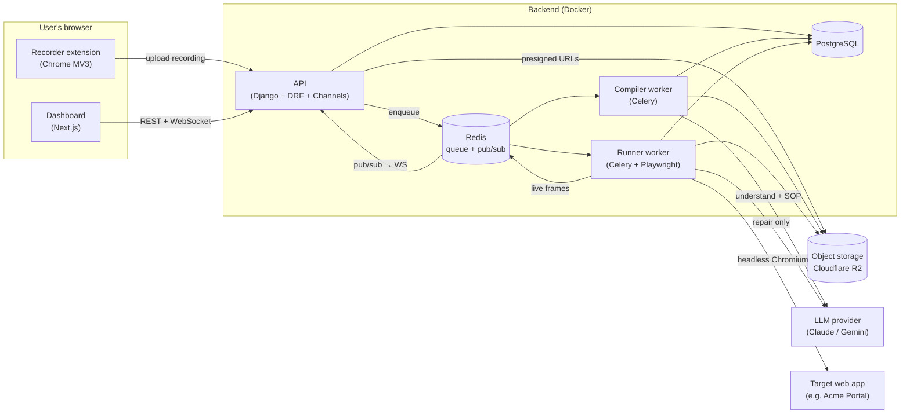
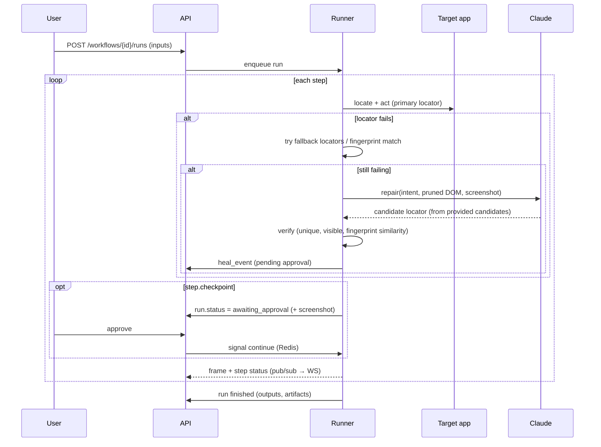

# 03 · System Architecture

## High-level view



## Components

| Component | Responsibility | Scaling unit |
|---|---|---|
| **Recorder extension** | Capture events + screenshots, mask secrets, upload | Per user |
| **Dashboard (web)** | Review/edit workflows, run, live view, approvals, analytics | Stateless, CDN |
| **API** | Auth, CRUD, presigned uploads, enqueue jobs, WebSocket fan-out, audit log | Stateless replicas |
| **Compiler worker** | Normalize events → Claude → spec + SOP → validate | Horizontal, CPU-light |
| **Runner worker** | Execute spec in isolated Chromium; checkpoints; self-heal; stream frames | Horizontal, **1 browser per concurrent run** |
| **PostgreSQL** | System of record (tenants, workflows, versions, runs, audit) | Managed DB |
| **Redis** | Celery broker, run-control signals (approve/cancel), live-frame pub/sub | Single instance (MVP) |
| **R2** | Screenshots, raw recordings, SOP PDFs, run artifacts | Managed |
| **LLM provider** (Claude / Gemini) | Compile (vision + structured output) and repair | External |

## Core flows

### 1. Record → compile

```mermaid
sequenceDiagram
  participant U as User
  participant X as Extension
  participant A as API
  participant S as R2
  participant C as Compiler
  participant L as Claude
  U->>X: Start recording, do task, Stop + description
  X->>A: POST /recordings (metadata)
  A-->>X: recording_id + presigned upload URLs
  X->>S: PUT events.json, frames/*.webp
  X->>A: POST /recordings/{id}/complete
  A->>C: enqueue compile(recording_id)
  C->>S: fetch events + frames
  C->>C: normalize (deterministic)
  C->>L: understand(steps, key frames, description) → structured JSON
  C->>C: build locators, validate spec (JSON Schema)
  C->>L: write SOP (Markdown)
  C->>A: workflow v1 + SOP saved; status=ready
  A-->>U: dashboard shows workflow (WS event)
```

### 2. Run with checkpoint and heal



## Key design principles

1. **The spec is the source of truth.** Code (Playwright export) and the SOP are generated *from* it. See [ADR-0002](adr/0002-workflow-spec-as-source-of-truth.md).
2. **AI at authoring and repair time, never in the normal run path.** See [ADR-0003](adr/0003-deterministic-runtime-ai-only-for-compile-and-heal.md).
3. **Record structured DOM events + screenshots, not just video.** See [ADR-0001](adr/0001-record-dom-events-plus-screenshots.md).
4. **Untrusted page content.** Text from the target app is data, never instructions to the AI (prompt-injection defense). See [11](11-security-privacy.md).
5. **Isolation per run.** A fresh browser context per run. No cookies are shared across workflows or tenants.
6. **Everything is versioned and audited.**

## Repository layout

```
watchonce/
├─ apps/
│  ├─ web/                    # Next.js (App Router) + TS + Tailwind + shadcn/ui
│  │  ├─ app/(auth)/ app/(dashboard)/workflows/[id]/ runs/[id]/ ...
│  │  └─ lib/api-client.ts    # generated from OpenAPI
│  └─ extension/              # Chrome MV3 + TS + Vite
│     ├─ src/background.ts    # service worker: session, screenshots, upload
│     ├─ src/content.ts       # event capture + element descriptors
│     └─ src/popup/           # start/stop UI
├─ services/core/             # Python 3.12, uv-managed Django project
│  ├─ manage.py
│  ├─ config/                 # settings/ (base, dev, prod), urls.py, asgi.py (Channels), celery.py
│  ├─ accounts/               # Django app: users, orgs, memberships, API tokens, auth views
│  ├─ recordings/             # Django app: recordings, presigned uploads
│  ├─ workflows/              # Django app: workflows, versions, secret bindings, exports
│  ├─ runs/                   # Django app: runs, batches, steps, checkpoints, consumers.py (WebSockets)
│  ├─ heals/                  # Django app: heal events + decisions
│  ├─ vault/                  # Django app: encrypted secrets
│  ├─ audit/                  # Django app: append-only audit log
│  └─ engine/                 # framework-agnostic core used by Celery tasks
│     ├─ compiler/            # normalize.py, understand.py, locators.py, sop.py
│     ├─ runner/              # executor.py, healer.py, checkpoints.py, live.py
│     └─ llm/                 # LLMProvider interface, Claude + Gemini providers, prompts/, schemas/
├─ packages/spec/
│  ├─ workflow.schema.json    # single source; TS types + Pydantic models generated
│  └─ examples/
├─ demo/acme-portal/          # mock legacy portal with a UI-mutation toggle
├─ evals/                     # golden recordings, heal mutation suite, runner scripts
├─ infra/                     # docker-compose.yml, Dockerfiles, Caddyfile
└─ docs/
```
