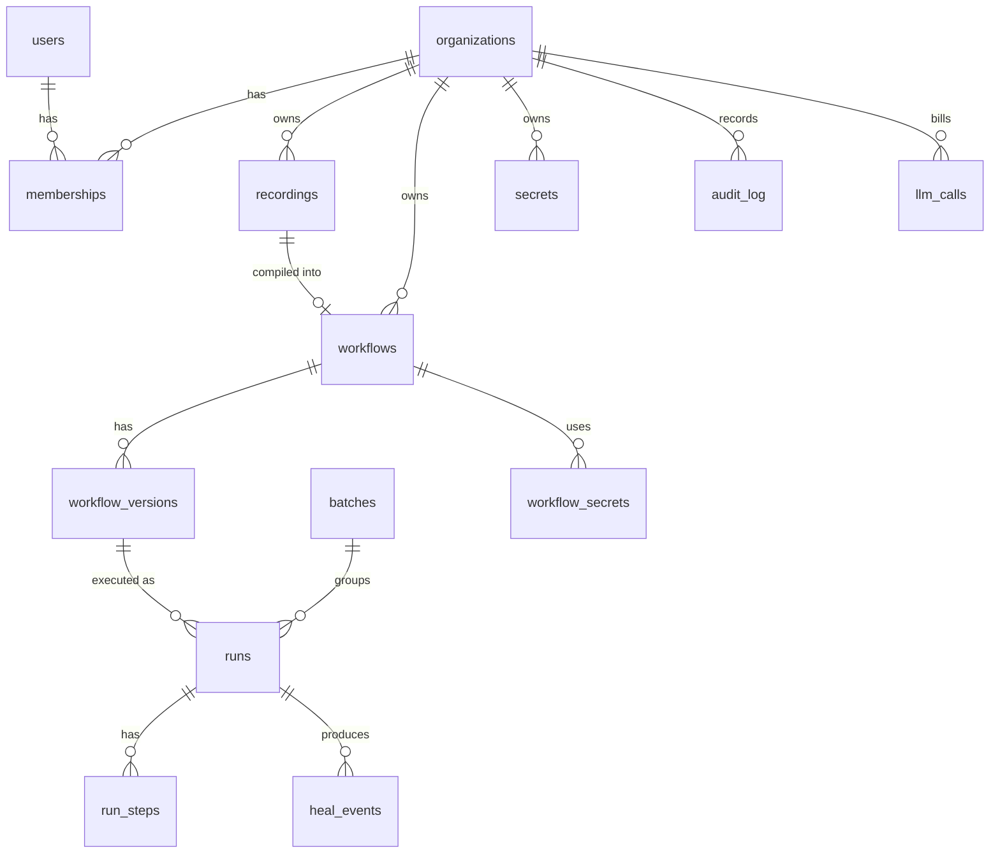

# 09 · Data Model (PostgreSQL)

All tables have `id` (ULID, text, prefixed e.g. `wf_…`), `created_at`, `updated_at`. All tenant-owned tables have `org_id` and **every query is scoped by `org_id`** (enforced in the repository layer + tested).

## Tables

### organizations
| Column | Type | Notes |
|---|---|---|
| name | text | |
| plan | text | `free` / `pro` / `enterprise` |
| settings | jsonb | default heal policy, data retention days |

### users
| email (unique, citext) | password_hash (argon2id, nullable for OAuth) | name | google_sub (nullable) | last_login_at |

### memberships
| org_id | user_id | role (`owner` / `member`) | unique(org_id, user_id) |

### api_tokens
| org_id | user_id | name | token_hash (sha256) | last_used_at | expires_at | revoked_at |
Used by the extension. Only the hash is stored. Shown once.

### recordings
| Column | Type | Notes |
|---|---|---|
| org_id, user_id | fk | |
| description | text | user's task description |
| status | text | `uploading` / `uploaded` / `compiling` / `compiled` / `failed` |
| storage_prefix | text | `org/{org}/rec/{id}/` |
| event_count, duration_ms | int | |
| start_url | text | |
| error | text | |

### workflows
| org_id | name | description | recording_id | active_version_id | manual_duration_sec (for hours-saved) | archived_at |

### workflow_versions
| Column | Type | Notes |
|---|---|---|
| workflow_id | fk | |
| version | int | unique(workflow_id, version) |
| status | text | `draft` / `active` / `pending_heal` / `archived` |
| spec | jsonb | the full spec ([05](05-workflow-spec.md)) |
| spec_hash | text | sha256 of canonical JSON |
| sop_markdown | text | |
| created_by | text | `user:{id}` / `compiler` / `healer` |
| parent_version_id | fk nullable | |
| change_note | text | |

### secrets
| org_id | name | ciphertext (bytea) | data_key_ciphertext (bytea) | key_version | fields (text[]) | created_by | rotated_at |
Values are **never returned by the API**.

### workflow_secrets
| workflow_id | secret_name (as in spec) | secret_id |

### batches
| org_id | workflow_id | version_id | input_file_ref | total | succeeded | failed | status | approve_all (bool) | approved_by |

### runs
| Column | Type | Notes |
|---|---|---|
| org_id, workflow_id, version_id | fk | version pinned at start |
| batch_id, row_index | nullable | |
| triggered_by | text | `user:{id}` / `batch` / `schedule` (v0.2) / `api` |
| status | text | see [08](08-runner-and-self-healing.md) |
| inputs | jsonb | **secrets never stored here** |
| outputs | jsonb | |
| error_code, error_message | text | |
| started_at, finished_at | timestamptz | |
| artifacts_prefix | text | R2 path for screenshots/trace |
| llm_cost_usd | numeric(10,4) | sum of heal calls |

### run_steps
| run_id | step_id | seq | status (`ok`/`healed`/`failed`/`skipped`/`awaiting_approval`) | locator_used | rung (L0–L4) | started_at | finished_at | screenshot_ref | error |

### heal_events
| run_id | workflow_id | step_id | rung | before_locators (jsonb) | after_locators (jsonb) | score | model_confidence | explanation | before_image_ref | after_image_ref | resulting_version_id | decision (`pending`/`approved`/`rejected`/`auto`) | decided_by | decided_at |

### checkpoint_decisions
| run_id | step_id | decision | decided_by | decided_at | screenshot_ref |

### audit_log
| org_id | actor (`user:{id}`/`system`) | action (e.g. `workflow.version.activated`) | entity_type | entity_id | metadata (jsonb) | ip | user_agent |
Append-only. No UPDATE/DELETE grants for the app role.

### llm_calls
| org_id | purpose (`understand`/`sop`/`repair`) | entity_id | provider (`claude`/`gemini`) | model | prompt_version | input_tokens | output_tokens | cache_read_tokens | cost_usd | latency_ms | stop_reason |

## Indexes (initial)
- `runs (org_id, workflow_id, created_at desc)`, `runs (status) where status in ('queued','running','awaiting_approval')`
- `workflow_versions (workflow_id, status)`
- `audit_log (org_id, created_at desc)`
- `heal_events (workflow_id, decision)`

## Retention
- Recording frames and run screenshots: default 30 days (org setting), deleted by a nightly job
- Specs, versions, audit log: kept for the lifetime of the org
